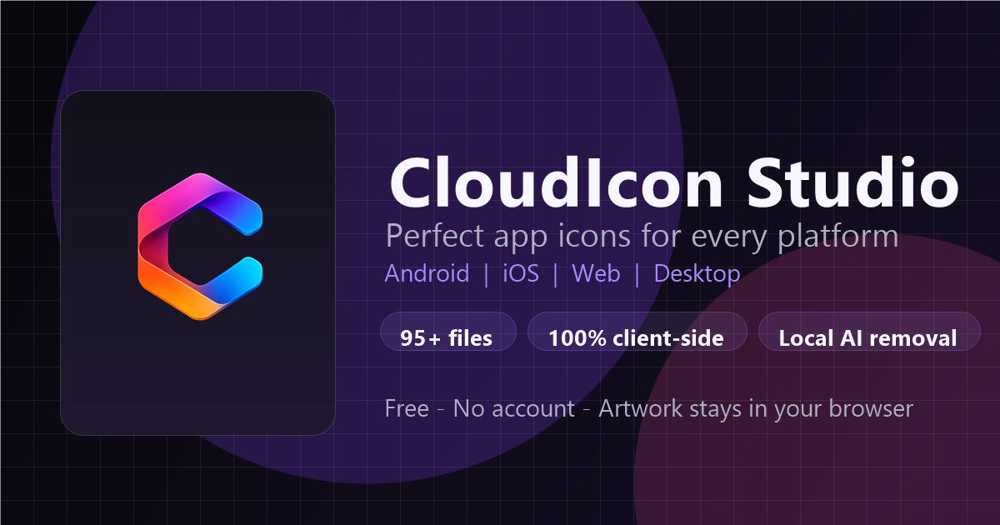
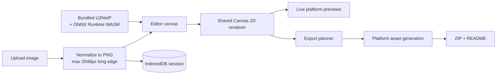
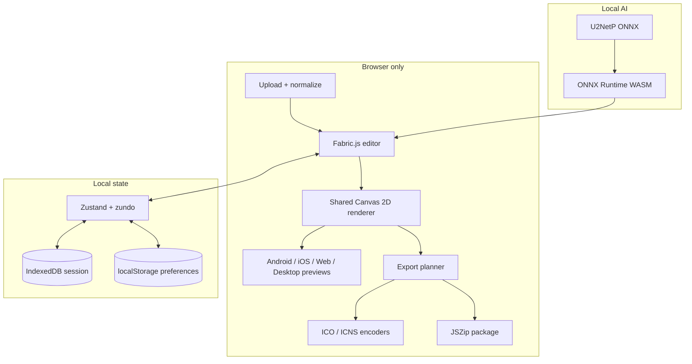

<div align="center">
  <a href="https://cloudicon.vercel.app/editor">
    
  </a>

  <h1>CloudIcon Studio</h1>

  <p><strong>One image in. A complete, platform-ready icon pack out.</strong><br />
  A free, privacy-first icon studio for Android, iOS, Web/PWA, Windows, macOS, and Linux.</p>

  <p>
    <a href="https://nextjs.org"></a>
    <a href="https://react.dev"></a>
    <a href="https://www.typescriptlang.org"></a>
    <a href="https://tailwindcss.com"></a>
    <a href="LICENSE"></a>
  </p>

  <p>
    <a href="https://cloudicon.vercel.app/editor"><strong>Open the Editor</strong></a>
    &nbsp;·&nbsp;
    <a href="https://cloudicon.vercel.app/docs">Documentation</a>
    &nbsp;·&nbsp;
    <a href="https://cloudicon.vercel.app/how-it-works">How it works</a>
    &nbsp;·&nbsp;
    <a href="https://github.com/devasishpal/Cloud_Icon_Studio/issues">Report a bug</a>
  </p>
</div>

> [!IMPORTANT]
> CloudIcon Studio runs entirely in your browser. Artwork, edits, local AI background removal, and ZIP generation never touch a server. No account, no uploads, no tracking.

---

## Why CloudIcon Studio

- **Upload once, export everywhere.** One source image becomes launcher icons, adaptive icons, favicons, PWA assets, Windows ICO, macOS ICNS, Linux PNGs, splash screens, and social cards.
- **Local AI background removal.** A bundled U2NetP model runs on-device through ONNX Runtime Web and WebAssembly. No image is sent anywhere.
- **Reload-safe editing.** Your artwork and every edit are saved to IndexedDB, so `/editor` restores the exact session after a refresh.
- **A real editor, not a resize form.** Crop, rotate, pan, zoom, fit modes, padding, shape masks, solid/gradient/transparent backgrounds, adjustments, shadows, borders, flips, and 80-step undo/redo.
- **Previews that match the export.** The same shared Canvas 2D renderer powers the editor canvas, device mockups, and every exported file.
- **Structured, production-ready ZIPs.** Platform folders, adaptive-icon XML, iOS `Contents.json`, web manifests, multi-resolution ICO/ICNS, and an optional README are generated automatically.

---

## Quick start

### Prerequisites

- **Node.js 20.9+** (Node 22 LTS recommended)
- npm, pnpm, yarn, or bun

### Run locally

```bash
git clone https://github.com/devasishpal/Cloud_Icon_Studio.git
cd Cloud_Icon_Studio
npm install
npm run dev
```

Open [http://localhost:3000](http://localhost:3000).

### Production build

```bash
npm run build
npm start
```

The project is configured for Vercel through `vercel.json`, but the production build works on any Node.js host.

---

## How it works



1. **Upload** a PNG, JPG, WebP, or SVG (up to 25 MB). Large bitmaps are normalized to PNG with a 2048px long edge; SVGs are rasterized.
2. **Edit** on the Fabric.js canvas with the toolbar and property panels.
3. **Preview** the live result on Android, iOS, Web, and Desktop mockups.
4. **Export** a preset and configure compression, naming, manifests, and source-image inclusion.
5. **Download** a structured ZIP generated entirely in the browser.

---

## Editor

| Tool | What it does |
|---|---|
| **Move & Transform** | Drag the artwork, scale it, rotate it, and fine-tune position with sliders. Fit modes: Contain, Cover, Stretch. |
| **Pan / Zoom** | Pan the artboard and zoom from 10% to 500%. `Ctrl/Cmd+0` resets the view. |
| **Crop** | Crop with 1:1, 4:3, 16:9, Free, or Custom aspect ratios. |
| **Rotate** | Rotate in 90° steps or use free rotation. |
| **Padding** | Adjust artwork padding from -20% to 40% with live feedback. |
| **Shape** | Apply Circle, Squircle, Rounded Square, Teardrop, or Square masks. |
| **Background** | Solid color, nine gradient presets, or transparent. |
| **Adjustments** | Brightness, contrast, saturation, hue, blur, grayscale, and opacity. |
| **Effects** | Drop shadow, border, and horizontal/vertical flips. |
| **Remove Background** | Local U2Net AI removal, chroma-key removal with corner sampling, tolerance control, and palette extraction. |
| **Grid / Safe Area** | Alignment grid and platform safe-zone guides. Only one safe-area guide is shown at a time. |

### Local AI background removal

The **Remove Background** panel offers two independent methods:

- **U2Net AI** — a 4.4 MB U2NetP model (`public/models/u2netp.onnx`) runs through `onnxruntime-web` with single-threaded WebAssembly SIMD. The model and runtime are served from this app (`public/ort/`), not a CDN. Inference uses a 320×320 input and restores the mask at the source resolution, preserving soft hair and edge detail.
- **Chroma key** — removes one flat color with adjustable tolerance. A corner picker samples the background color automatically. This is the fastest option for logos and flat-color artwork.

Both methods replace the working image while preserving the rest of your edits, and both are undoable.

### Live previews

| Tab | What you can inspect |
|---|---|
| **Android** | Home-screen launcher grid, Play Store card, and Material You monochrome icon. |
| **iOS** | iPhone-style home screen, App Store card, and notification preview. |
| **Web** | Browser chrome, favicon in the address bar, navbar logo, and PWA install card. |
| **Desktop** | macOS Dock, Windows taskbar, and desktop shortcut. |

All four previews render from the same editor state, so every change appears immediately in each tab.

---

## Export presets

| Preset | Assets | What you get |
|---|---:|---|
| **Full Pack** | **95** | Every asset below, organized into platform folders. `README.txt` adds one ZIP entry when enabled. |
| **Android** | 32 | Legacy, round, adaptive foreground/background, monochrome, notification, Play Store, and XML resources. |
| **iOS** | 20 | 19 AppIcon PNGs plus `Contents.json`. |
| **Web** | 12 | Favicons, apple-touch-icon, PWA icons, maskable icon, Windows tile, ICO, Safari pinned-tab SVG, `site.webmanifest`, and `browserconfig.xml`. |
| **PWA Pack** | 5 | Install icons plus `site.webmanifest`. |
| **Desktop** | 17 | Windows tiles + ICO, macOS ICNS, and Linux hicolor PNGs. |
| **Splash Screens** | 6 | iPhone and iPad launch screens in portrait and landscape. |
| **Social Cards** | 3 | Open Graph, Twitter card, and square social image. |
| **Minimal** | 6 | The six files most projects actually need. |

### Export options

- **Compression:** Fast (`STORE`), Balanced (DEFLATE level 6), Maximum (DEFLATE level 9).
- **Pack name:** Custom filename with an optional timestamp.
- **README.txt:** Per-platform installation instructions and a folder map.
- **Manifest files:** Android adaptive-icon XML, iOS `Contents.json`, web manifests, and `browserconfig.xml`.
- **Source image:** Include the original upload in `source/`.
- **Transparent backgrounds:** Preserved where supported; iOS and PWA assets are flattened onto your chosen background color because those platforms require opaque icons.

---

## What the full pack contains

| Platform | Files | Details |
|---|---:|---|
| **Android** | 32 | 27 PNGs + 5 XML files |
| **iOS** | 20 | 19 PNGs + `Contents.json` |
| **Web** | 12 | 10 images/ICO/SVG + 2 manifests |
| **PWA** | 5 | 4 PNGs + `site.webmanifest` |
| **Desktop** | 17 | 8 Windows PNGs + ICO + ICNS + 7 Linux PNGs |
| **Splash** | 6 | iPhone/iPad portrait and landscape |
| **Social** | 3 | Open Graph, Twitter, square |
| **Total** | **95** | Plus `README.txt` when enabled |

### Android

| Asset | Sizes / densities |
|---|---|
| Legacy launcher + round | ldpi 36, mdpi 48, hdpi 72, xhdpi 96, xxhdpi 144, xxxhdpi 192 |
| Adaptive foreground | mdpi 108, hdpi 162, xhdpi 216, xxhdpi 324, xxxhdpi 432 |
| Adaptive background + monochrome | 432×432 |
| Notification | ldpi 18, mdpi 24, hdpi 36, xhdpi 48, xxhdpi 72, xxxhdpi 96 |
| Store / web | Play Store 512, `ic_launcher-web` 512 |
| XML | `mipmap-anydpi-v26`, `mipmap-anydpi-v33`, and background color resource |

### iOS

19 AppIcon entries covering iPhone, iPad, Notification, Settings, Spotlight, and App Store — from 20×20 up to 1024×1024 — plus a correctly formatted `Contents.json` asset catalog.

### Web and PWA

`favicon-16x16.png`, `favicon-32x32.png`, `favicon-48x48.png`, a multi-resolution `favicon.ico` (16/32/48/64), `apple-touch-icon.png` (180), `android-chrome-192x192.png`, `android-chrome-512x512.png`, `maskable-512x512.png`, `mstile-150x150.png`, `safari-pinned-tab.svg`, `site.webmanifest`, and `browserconfig.xml`.

### Desktop

- **Windows:** tiles at 16, 24, 32, 48, 64, 128, 256, and 150; multi-resolution `app.ico`.
- **macOS:** multi-resolution `app.icns` from 16 to 1024.
- **Linux:** hicolor PNGs at 16, 32, 48, 64, 128, 256, and 512.

### Example ZIP layout

```text
CloudIcon-Pack-2026-10-29-1200.zip
├── android/
│   ├── mipmap-mdpi/
│   ├── mipmap-anydpi-v26/
│   ├── mipmap-anydpi-v33/
│   ├── drawable-*/
│   ├── values/
│   ├── playstore-icon.png
│   └── ic_launcher-web.png
├── iOS/
│   └── AppIcon.appiconset/
│       ├── Icon-App-*.png
│       └── Contents.json
├── web/
│   ├── favicon-*.png
│   ├── favicon.ico
│   ├── apple-touch-icon.png
│   ├── android-chrome-*.png
│   ├── maskable-512x512.png
│   ├── mstile-150x150.png
│   ├── safari-pinned-tab.svg
│   ├── site.webmanifest
│   └── browserconfig.xml
├── pwa/
├── desktop/
│   ├── windows/
│   ├── macos/
│   └── linux/
├── splash/
├── social/
└── README.txt
```

---

## Tech stack

| Area | Technology |
|---|---|
| **Framework** | Next.js 16.2.6 (App Router), React 19.2.4 |
| **Language** | TypeScript 5.9 |
| **Styling** | Tailwind CSS 4.3, shadcn/ui (`base-nova`), Base UI, `tw-animate-css` |
| **Canvas** | Fabric.js 7.3.1 + a shared Canvas 2D renderer |
| **State** | Zustand 5.0 + zundo 2.3 (debounced 80-step history) |
| **Local AI** | onnxruntime-web 1.31 + U2NetP |
| **Resampling** | `createImageBitmap` with pica 9 fallback and unsharp masking |
| **Animation** | Framer Motion 12.38 |
| **Icons** | Lucide React 1.16, Simple Icons 16.19 |
| **Upload** | react-dropzone 15 |
| **Export** | JSZip 3.10, file-saver 2.0, custom ICO/ICNS encoders |
| **Persistence** | IndexedDB + localStorage |
| **Fonts** | Outfit and Geist Mono via `next/font` |
| **Deployment** | Vercel |

---

## Architecture



### Key modules

- **`src/lib/render.ts`** — the single renderer used by the editor, previews, and exports. Handles fit modes, transforms, shapes, gradients, adjustments, effects, and monochrome silhouettes.
- **`src/lib/processor.ts`** — builds the export plan for every preset, including exact asset paths and counts.
- **`src/lib/exporter.ts`** — orchestrates rendering, packaging, progress reporting, and download.
- **`src/lib/u2net.ts`** — local U2NetP preprocessing, inference, mask post-processing, and model caching.
- **`src/lib/image-ops.ts`** — upload normalization, chroma-key removal, palette extraction, and high-quality resizing.
- **`src/lib/icon-encoders.ts`** — dependency-free ICO and ICNS encoders.
- **`src/lib/idb.ts`** — self-repairing IndexedDB wrapper for editor sessions.
- **`src/store/useEditorStore.ts`** — Zustand store, zundo history, upload replacement, and serialized persistence.

---

## Project structure

```text
cloudicon-studio/
├── public/
│   ├── models/u2netp.onnx          # Bundled U2NetP model (4.4 MB)
│   ├── ort/                        # Local ONNX Runtime WASM runtime
│   ├── wallpapers/                 # Preview wallpapers
│   ├── icons + favicons            # App icons, maskable icon, Safari tab icon
│   ├── og-image.png                # Social card
│   ├── manifest.json               # PWA manifest
│   └── sw.js                       # Production service worker
├── src/
│   ├── app/
│   │   ├── page.tsx                # Home page
│   │   ├── layout.tsx              # Metadata, fonts, providers
│   │   ├── globals.css             # Tailwind CSS 4 + design tokens
│   │   ├── editor/page.tsx         # Editor shell
│   │   ├── docs/ faq/ how-it-works/
│   │   ├── blog/ changelog/ status/
│   │   ├── about/ contact/
│   │   ├── privacy/ terms/ cookies/ gdpr/ ccpa/
│   │   ├── robots.ts sitemap.ts viewport.ts
│   │   └── not-found.tsx
│   ├── components/
│   │   ├── editor/                 # Canvas, toolbar, transform, adjust, effects, background, crop, guides, remove-bg
│   │   ├── previews/               # Android, iOS, Web, Desktop, device/browser mockups, PWA/favicon/monochrome
│   │   ├── export/export-modal.tsx
│   │   ├── home/showcase-section.tsx
│   │   ├── layout/                 # Navbar, footer, page layout, sidebar
│   │   ├── ui/                     # shadcn/ui primitives
│   │   └── ...                     # Command palette, shortcuts, theme, consent, status bar
│   ├── lib/
│   │   ├── render.ts
│   │   ├── processor.ts
│   │   ├── exporter.ts
│   │   ├── zip-utils.ts
│   │   ├── u2net.ts
│   │   ├── image-ops.ts
│   │   ├── icon-encoders.ts
│   │   ├── idb.ts
│   │   ├── constants.ts
│   │   ├── helpers.ts
│   │   └── utils.ts
│   ├── store/useEditorStore.ts
│   └── types/index.ts
├── LICENSE
├── next.config.ts
├── eslint.config.mjs
├── postcss.config.mjs
├── tsconfig.json
├── components.json
├── vercel.json
└── package.json
```

`public/ort/**` is vendored ONNX Runtime glue and is excluded from ESLint.

---

## Privacy, persistence & PWA

### Your artwork stays local

- Images are read with `FileReader`, normalized in a canvas, and rendered locally.
- Background removal runs in the browser with a bundled model. No image-processing request is sent to a server.
- ZIP files are built in memory with JSZip and saved with `file-saver`.
- There are no accounts, no analytics, and no tracking cookies. The consent banner stores a local preference only.
- Security headers include `X-Frame-Options: DENY`, `X-Content-Type-Options: nosniff`, a strict referrer policy, and a restrictive permissions policy.

### Reload-safe sessions

The editable state is stored in IndexedDB under `cloudicon-db` / `state` / `cloudicon-editor-state-v2`. Writes are serialized and flushed on `pagehide`/`visibilitychange`, so a quick reload cannot restore an older image. Uploading a new image replaces the saved artwork; **Reset** clears it. Export history (last 50 exports) and theme/consent preferences live in localStorage.

### Installable PWA, no install popup

CloudIcon Studio has a web app manifest, app icons, a maskable icon, and a production-only service worker. It never shows an automatic install prompt. If you want an app-like window, use your browser's **Install** or **Add to Home Screen** menu.

The service worker caches hashed build assets, icons, wallpapers, and the AI model after first use. Page navigations and RSC payloads stay network-first so deployments never serve a stale editor shell. Development mode disables the service worker and clears stale dev caches.

---

## Keyboard shortcuts

| Shortcut | Action |
|---|---|
| `Ctrl/Cmd + O` | Upload a new image |
| `Ctrl/Cmd + E` | Open the export dialog |
| `Ctrl/Cmd + Z` | Undo |
| `Ctrl/Cmd + Shift + Z` or `Ctrl/Cmd + Y` | Redo |
| `Ctrl/Cmd + G` | Toggle the alignment grid |
| `Ctrl/Cmd + 0` | Reset zoom and pan |
| `Ctrl/Cmd + Shift + P` | Open the command palette |
| `+` / `-` | Zoom in / out |
| `Escape` | Close a modal, cancel crop, or return to Select |
| `V` | Select / transform |
| `H` | Pan |
| `C` | Crop |
| `R` | Rotate |
| `B` | Background |
| `A` | Adjustments |
| `E` | Effects |
| `P` | Padding |
| `S` | Shape |

Single-key tools are ignored while typing in an input, textarea, select, or contenteditable element.

---

## Browser support

CloudIcon Studio targets current **Chrome, Edge, Firefox, and Safari 15+** on desktop and mobile. It relies on the Canvas API, WebAssembly SIMD for local AI removal, IndexedDB for session storage, and ES2020+ JavaScript. Internet Explorer is not supported.

---

## Development

| Command | Purpose |
|---|---|
| `npm run dev` | Start the Next.js dev server |
| `npm run build` | Create a production build |
| `npm start` | Serve the production build |
| `npm run lint` | Run ESLint |
| `npx tsc --noEmit` | Type-check without emitting |

Before opening a pull request, run:

```bash
npm run lint
npx tsc --noEmit
npm run build
```

---

## Roadmap

- [x] Local AI background removal with U2NetP
- [x] Reload-safe IndexedDB sessions
- [x] Full Android, iOS, Web, PWA, Desktop, splash, and social export packs
- [ ] SVG/vector export
- [ ] Batch processing for multiple icons
- [ ] Platform guideline overlays (Apple HIG, Material Design)
- [ ] Optional mask refinement brush
- [ ] Opt-in cloud sync via WebDAV or iCloud

---

## Contributing

Contributions are welcome.

1. Fork the repository.
2. Create a feature branch: `git checkout -b feat/my-feature`.
3. Make your changes and run the checks above.
4. Commit: `git commit -m 'feat: add my feature'`.
5. Push and open a pull request.

Please keep image processing client-side, use the shared renderer in `src/lib/render.ts` for anything that appears in previews or exports, and avoid adding network requests for user artwork.

---

## License

CloudIcon Studio is released under the [MIT License](LICENSE).

---

## Support

- **Website:** [cloudicon.vercel.app](https://cloudicon.vercel.app)
- **Email:** [support@typely.in](mailto:support@typely.in)
- **Issues:** [GitHub Issues](https://github.com/devasishpal/Cloud_Icon_Studio/issues)
- **Source:** [github.com/devasishpal/Cloud_Icon_Studio](https://github.com/devasishpal/Cloud_Icon_Studio)

<div align="center">
  <sub>Built with care by <a href="https://github.com/devasishpal">Devasish Pal</a>. If CloudIcon Studio saves you time, consider starring the repository.</sub>
</div>
