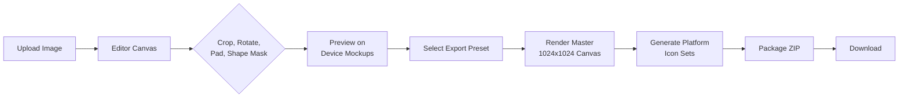
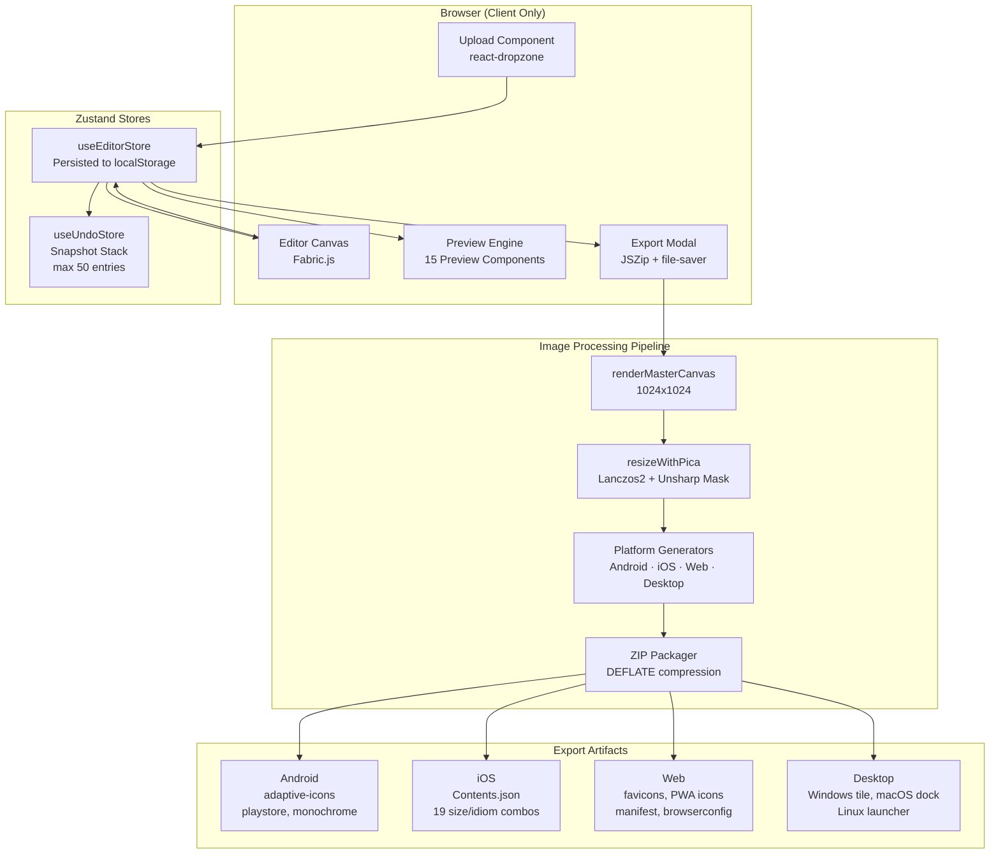
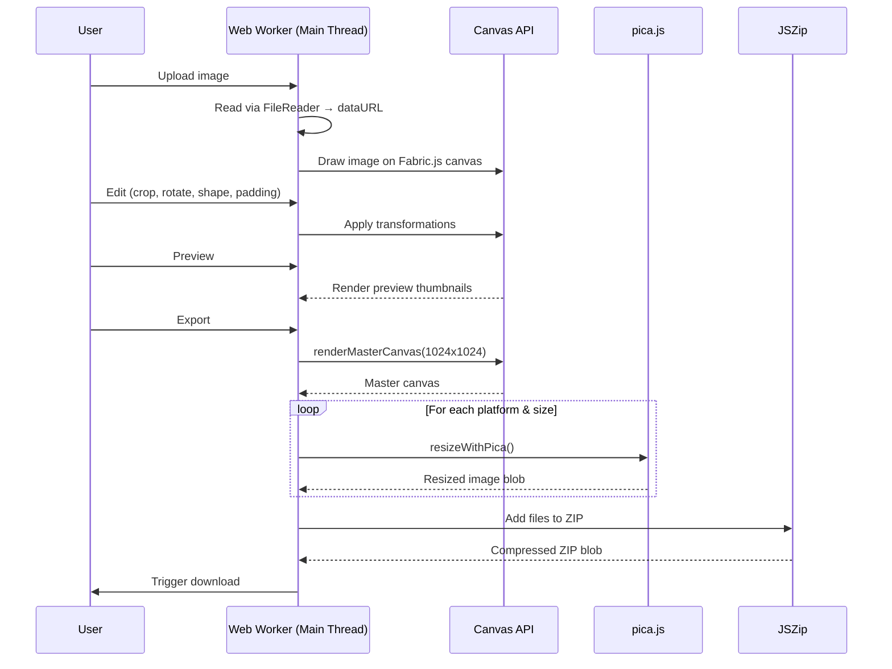
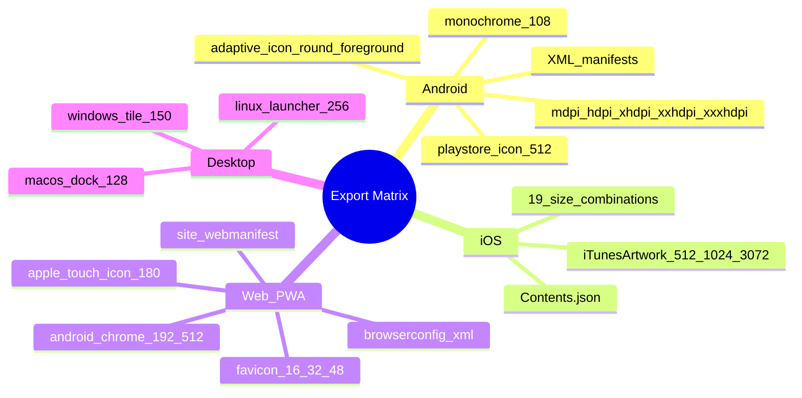
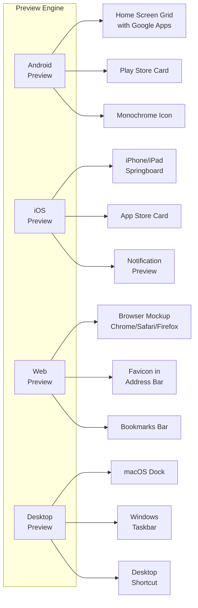

# CloudIcon Studio

> **Generate production-ready app icon packs for Android, iOS, Web, and Desktop — 100% in your browser.**

CloudIcon Studio is a free, privacy-first Progressive Web App that lets you upload a single image, edit it visually, and download a complete set of platform-optimized icons. No sign-ups, no servers, no data uploads. Everything runs client-side.

**[Launch Editor](https://cloudicon.vercel.app/editor)** &nbsp;·&nbsp; **[Documentation](https://cloudicon.vercel.app/docs)** &nbsp;·&nbsp; **[Report Bug](https://github.com/devasishpal/Cloud_Icon_Studio/issues)**

---

## Features

- **Upload once, export everywhere** — One source image generates icons for Android, iOS, Web (PWA), Windows, macOS, and Linux.
- **Visual editor** — Crop, rotate, pad, apply shape masks, and set background colors/gradients using an interactive Fabric.js canvas.
- **Realistic previews** — See your icon on device mockups (Pixel 8, Galaxy S24, iPhone 16 Pro, iPad Pro), browser chrome, desktop docks, and launcher grids.
- **Multiple export presets** — Full Pack, Android Only, iOS Only, Web Only, PWA Pack, Desktop Only, or Minimal.
- **Undo/Redo** — Full undo/redo stack for all editing operations.
- **PWA enabled** — Install as a standalone app, work offline, and persist your work locally.
- **Zero privacy risk** — No image data ever leaves your device. No accounts. No tracking.

---

## How It Works



1. **Upload** — Drag & drop or select a PNG, JPG, WEBP, or SVG file (max 25 MB).
2. **Edit** — Use the toolbar to crop, rotate, adjust padding, apply shape masks (circle, squircle, rounded-square, teardrop), and set background colors or gradients.
3. **Preview** — Switch between Android, iOS, Web, and Desktop preview tabs. Toggle dark/light mode, change device type, or swap wallpapers.
4. **Export** — Choose a preset (Full Pack, Android Only, iOS Only, Web Only, PWA Pack, Desktop Only, or Minimal). Configure compression, naming, and metadata options.
5. **Download** — Receive a structured ZIP archive with platform-specific folders, manifest files, and a detailed README.

---

## Architecture



### Data Flow



---

## Tech Stack

| Category | Technology |
|---|---|
| **Framework** | Next.js 16.2.6 (App Router, React 19.2.4) |
| **Language** | TypeScript 5.x |
| **Styling** | Tailwind CSS 4.x + `tw-animate-css` |
| **UI Library** | shadcn/ui (`base-nova` style) |
| **State Management** | Zustand 5.x (persisted to localStorage) |
| **Image Editing** | Fabric.js 7.3.1 |
| **Image Resizing** | pica 9.0.1 (Lanczos2 filter) |
| **Animation** | Framer Motion 12.x |
| **Icons** | Lucide React, Simple Icons 16.x |
| **File Upload** | react-dropzone |
| **ZIP Packaging** | JSZip |
| **File Save** | file-saver |
| **Fonts** | Outfit (sans), Geist Mono (mono) via `next/font` |
| **Deployment** | Vercel |

---

## Platform Support & Export Matrix



### Generated Files Per Platform

#### Android
| Density | Launcher | Round | Foreground | Size (px) |
|---|---|---|---|---|
| mdpi | `mipmap-mdpi/ic_launcher.png` | `ic_launcher_round.png` | `ic_launcher_foreground.png` | 48×48 |
| hdpi | `mipmap-hdpi/ic_launcher.png` | `ic_launcher_round.png` | `ic_launcher_foreground.png` | 72×72 |
| xhdpi | `mipmap-xhdpi/ic_launcher.png` | `ic_launcher_round.png` | `ic_launcher_foreground.png` | 96×96 |
| xxhdpi | `mipmap-xxhdpi/ic_launcher.png` | `ic_launcher_round.png` | `ic_launcher_foreground.png` | 144×144 |
| xxxhdpi | `mipmap-xxxhdpi/ic_launcher.png` | `ic_launcher_round.png` | `ic_launcher_foreground.png` | 192×192 |
| — | `playstore-icon.png` | — | — | 512×512 |
| — | `ic_launcher-web.png` | — | — | 512×512 |
| — | `monochrome.png` | — | — | 108×108 |

#### iOS
| Size (px) | Idiom | Scale |
|---|---|---|
| 40×40 | iPhone | 2× |
| 60×60 | iPhone | 3× |
| 58×58 | iPhone/iPad | 2× |
| 76×76 | iPad | 2× |
| 83.5×83.5 | iPad | 2× |
| 1024×1024 | universal | 1× |
| +12 more combinations | iPad, iPhone, marketing | 1×, 2×, 3× |

#### Web (PWA)
| File | Size (px) |
|---|---|
| `favicon-16x16.png` | 16×16 |
| `favicon-32x32.png` | 32×32 |
| `favicon-48x48.png` | 48×48 |
| `apple-touch-icon-180x180.png` | 180×180 |
| `android-chrome-192x192.png` | 192×192 |
| `android-chrome-512x512.png` | 512×512 |

#### Desktop
| File | Platform | Size (px) |
|---|---|---|
| `windows-tile-150x150.png` | Windows | 150×150 |
| `macos-dock-128x128.png` | macOS | 128×128 |
| `linux-launcher-256x256.png` | Linux | 256×256 |

---

## Project Structure

```
cloudicon-studio/
├── public/
│   ├── manifest.json          # PWA manifest
│   ├── sw.js                  # Service worker (offline caching)
│   ├── robots.txt
│   ├── og-image.png
│   ├── wallpapers/            # Preview wallpaper backgrounds
│   └── *.svg                  # Static icons
├── src/
│   ├── app/
│   │   ├── page.tsx           # Landing / home page
│   │   ├── layout.tsx         # Root layout (metadata, fonts, providers)
│   │   ├── globals.css        # Tailwind CSS + custom utilities
│   │   ├── viewport.ts        # Viewport configuration
│   │   ├── sitemap.ts         # XML sitemap generator
│   │   ├── robots.ts          # robots.txt generator
│   │   ├── editor/
│   │   │   └── page.tsx       # Editor workspace
│   │   ├── privacy/
│   │   ├── terms/
│   │   ├── cookies/
│   │   ├── gdpr/
│   │   ├── ccpa/
│   │   ├── about/
│   │   ├── contact/
│   │   ├── changelog/
│   │   ├── status/
│   │   ├── docs/
│   │   ├── how-it-works/
│   │   └── blog/
│   ├── components/
│   │   ├── editor/            # Canvas + editing tools
│   │   │   ├── fabric-canvas.tsx
│   │   │   ├── image-editor.tsx
│   │   │   ├── toolbar.tsx
│   │   │   ├── tool-card.tsx
│   │   │   ├── zoom-controls.tsx
│   │   │   ├── rotation-controls.tsx
│   │   │   ├── padding-controls.tsx
│   │   │   ├── background-panel.tsx
│   │   │   ├── crop-overlay.tsx
│   │   │   ├── safe-area-overlay.tsx
│   │   │   ├── grid-overlay.tsx
│   │   │   ├── preview-panel.tsx
│   │   │   └── device-mockups.tsx
│   │   ├── previews/          # Platform preview mockups
│   │   │   ├── preview-engine.tsx
│   │   │   ├── android-preview.tsx
│   │   │   ├── ios-preview.tsx
│   │   │   ├── web-preview.tsx
│   │   │   ├── desktop-preview.tsx
│   │   │   ├── device-mockup.tsx
│   │   │   ├── browser-mockup.tsx
│   │   │   ├── favicon-preview.tsx
│   │   │   ├── navbar-preview.tsx
│   │   │   ├── pwa-preview.tsx
│   │   │   ├── monochrome-preview.tsx
│   │   │   ├── adaptive-icon-preview.tsx
│   │   │   ├── floating-preview-cards.tsx
│   │   │   ├── preview-tabs.tsx
│   │   │   └── preview-settings-panel.tsx
│   │   ├── export/
│   │   │   └── export-modal.tsx
│   │   ├── upload/
│   │   │   └── upload-box.tsx
│   │   ├── layout/
│   │   │   ├── navbar.tsx
│   │   │   ├── footer.tsx
│   │   │   ├── sidebar.tsx
│   │   │   └── page-layout.tsx
│   │   ├── ui/                # shadcn/ui primitives
│   │   │   ├── button.tsx
│   │   │   ├── input.tsx
│   │   │   ├── dialog.tsx
│   │   │   ├── dropdown-menu.tsx
│   │   │   ├── command.tsx
│   │   │   └── ... (16 total)
│   │   ├── theme/
│   │   │   ├── theme-provider.tsx
│   │   │   └── theme-toggle.tsx
│   │   ├── hero-section.tsx
│   │   ├── command-palette.tsx
│   │   ├── keyboard-shortcuts.tsx
│   │   ├── cookie-consent.tsx
│   │   ├── error-boundary.tsx
│   │   ├── json-ld.tsx
│   │   ├── install-pwa-prompt.tsx
│   │   ├── offline-banner.tsx
│   │   ├── status-bar.tsx
│   │   ├── mobile-bottom-bar.tsx
│   │   ├── left-panel.tsx
│   │   ├── right-panel.tsx
│   │   ├── tool-bar.tsx
│   │   ├── tool-card.tsx
│   │   ├── settings-panel.tsx
│   │   ├── live-preview-panel.tsx
│   │   └── workspace-layout.tsx
│   ├── lib/
│   │   ├── constants.ts       # Platform sizes, presets, defaults
│   │   ├── processor.ts       # Image rendering + resizing
│   │   ├── exporter.ts        # Export pipeline orchestration
│   │   ├── zip-utils.ts       # ZIP packaging + README generation
│   │   ├── helpers.ts         # Utility functions
│   │   └── utils.ts           # cn(), shapeStyle(), paddingStyle()
│   ├── store/
│   │   ├── useEditorStore.ts  # Zustand editor state (persisted)
│   │   └── undo-store.ts      # Zustand undo/redo stack
│   └── types/
│       └── index.ts           # All TypeScript interfaces
├── next.config.ts
├── tailwind.config.ts
├── postcss.config.mjs
├── eslint.config.mjs
├── tsconfig.json
├── components.json            # shadcn/ui config
├── vercel.json
├── package.json
└── .gitignore
```

---

## Getting Started

### Prerequisites

- Node.js 18+ (recommended: 20 LTS)
- npm, yarn, pnpm, or bun

### Installation

```bash
# Clone the repository
git clone https://github.com/devasishpal/Cloud_Icon_Studio.git

# Navigate to the project directory
cd Cloud_Icon_Studio

# Install dependencies
npm install

# Start the development server
npm run dev
```

Open [http://localhost:3000](http://localhost:3000) in your browser.

### Build for Production

```bash
npm run build
npm start
```

---

## Key Features in Detail

### Editor Tools

| Tool | Function |
|---|---|
| **Select** | Move and transform the image on the canvas |
| **Crop** | Crop with presets (1:1, 4:3, 16:9, Free) |
| **Shape** | Apply clip masks: Circle, Squircle, Rounded Square, Teardrop |
| **Zoom** | Zoom in/out with step controls and percentage display |
| **Rotate** | Rotate by 90° increments or free rotation slider |
| **Padding** | Adjust padding ratio with live preview |
| **Background** | Solid color picker or linear gradients (6 presets) |
| **Grid** | Toggle grid overlay with center crosshairs |
| **Safe Area** | Toggle safe area guides for platform icon zones |

### Export Presets

| Preset | Included Platforms | Icon Count |
|---|---|---|
| **Full Pack** | All platforms | 40+ files |
| **Android Only** | Android only | 18 files |
| **iOS Only** | iOS only | 22 files |
| **Web Only** | Web (PWA) only | 6 files |
| **PWA Pack** | Web + installable PWA icons | 8 files |
| **Desktop Only** | Windows, macOS, Linux | 3 files |
| **Minimal** | Essential icons (favicon, apple-touch, android-chrome) | 4 files |

### Export Options

- **Compression**: Fast (store), Balanced (level 6), Maximum (level 9)
- **Naming**: Preset styles or custom file name prefix
- **Timestamp**: Append timestamp to filenames
- **Include README**: Auto-generated usage instructions per platform
- **Include Manifests**: Adaptive-icon XML, Contents.json, site.webmanifest, browserconfig.xml
- **Include Source**: Embed the original uploaded image

### Preview System



---

## PWA & Offline

| Feature | Details |
|---|---|
| **Install Prompt** | `beforeinstallprompt` handler with custom UI |
| **Offline Support** | Cache-first service worker for core routes |
| **Persistent State** | Editor state saved to `localStorage` |
| **Background Sync** | Not required — all processing is synchronous and local |
| **Manifest** | `display: standalone` with `window-controls-overlay` |
| **Categories** | Design, Utilities, Productivity |

### Keyboard Shortcuts

| Shortcut | Action |
|---|---|
| `Ctrl+O` | Upload image |
| `Ctrl+E` | Open export modal |
| `Ctrl+Z` | Undo |
| `Ctrl+Shift+Z` / `Ctrl+Y` | Redo |
| `Ctrl+G` | Toggle grid overlay |
| `Ctrl+Shift+P` | Open command palette |
| `Escape` | Select tool / Close modals |

---

## Privacy & Security

CloudIcon Studio processes **everything on your device**:

- Images are read via `FileReader` into data URLs — **never uploaded**.
- All canvas rendering uses the browser's native Canvas API.
- ZIP generation happens in memory via JSZip.
- No cookies, no analytics, no external API calls.
- Editor state is saved only to `localStorage` — never synced to a server.
- Export history (last 50 exports) is stored locally and can be cleared anytime.

---

## Roadmap

- [ ] AI-powered background removal
- [ ] SVG export for vector icons
- [ ] Batch processing (multiple icons at once)
- [ ] Icon set theming (color palette sync across platforms)
- [ ] Platform-specific guideline overlays (Apple HIG, Material Design)
- [ ] Drag-and-drop reordering in export presets
- [ ] Cloud sync via WebDAV or iCloud (opt-in)

---

## Contributing

Contributions are welcome! Please follow these steps:

1. Fork the repository.
2. Create a feature branch: `git checkout -b feat/my-feature`.
3. Commit your changes: `git commit -m 'feat: add my feature'`.
4. Push to the branch: `git push origin feat/my-feature`.
5. Open a Pull Request.

Please ensure your code passes linting and type checking:

```bash
npm run lint
npx tsc --noEmit
```

---

## License

This project is licensed under the MIT License — see the [LICENSE](LICENSE) file for details.

---

## Support

- **Website**: [cloudicon.vercel.app](https://cloudicon.vercel.app)
- **Email**: support@typely.in
- **Issues**: [GitHub Issues](https://github.com/devasishpal/Cloud_Icon_Studio/issues)

---

<p align="center">
  Made with ❤️ by <a href="https://github.com/devasishpal">Devasish Pal</a>
</p>
